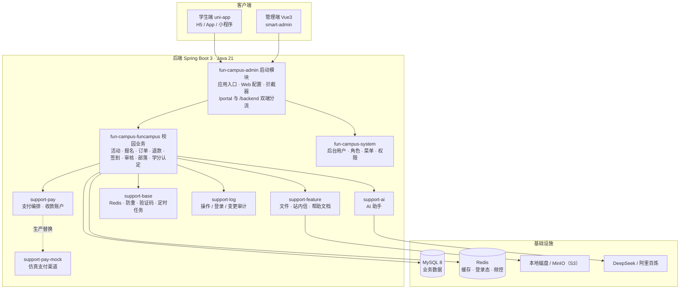
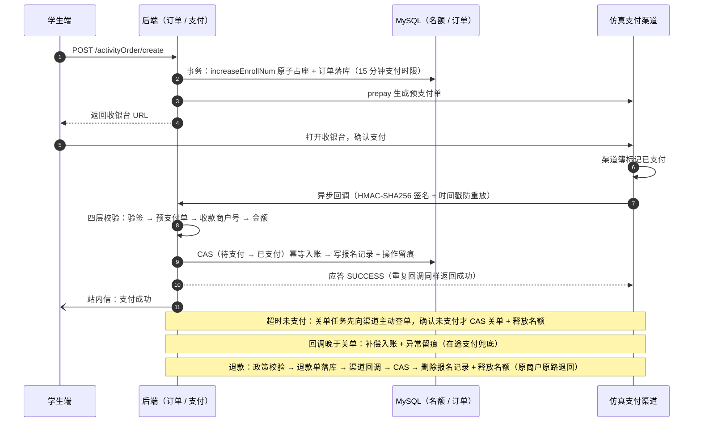
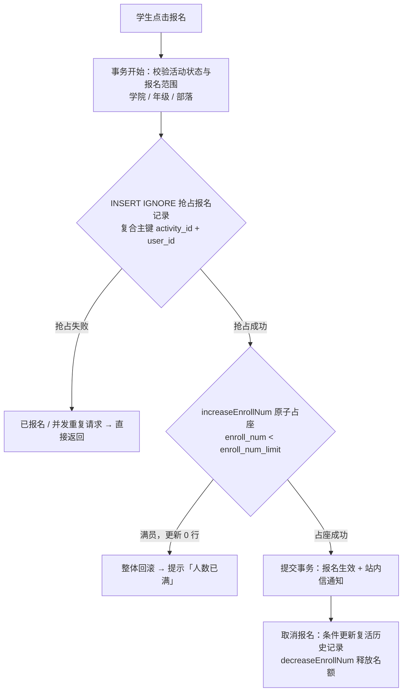
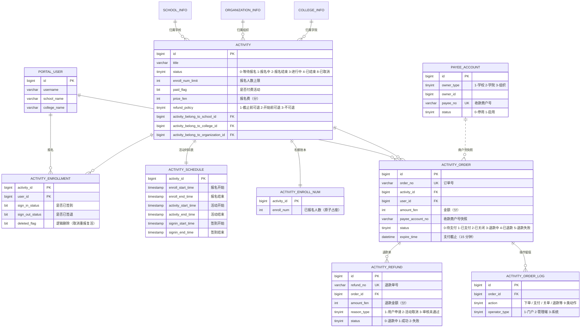

# Fun Campus · 校园第二课堂活动管理平台

> 面向高校「第二课堂」活动的双端管理平台：管理端（Vue3）+ 学生端（uni-app），覆盖活动从 **发布 → 审核 → 报名（免费 / 付费）→ 签到签退 → 评价 → 学分认定** 的完整生命周期。


**重要声明**：本软件为独立开发，与 PU口袋校园 无任何关联。所有代码、设计均为原创，仅借鉴了校园管理系统的一般功能概念。

---

## 核心亮点

| 能力 | 说明 |
|------|------|
| **付费报名全链路** | 下单锁座 → 渠道异步回调 → 报名生效 → 退款；独立支付模块抽象渠道接口 + 仿真 Mock 渠道（HMAC-SHA256 签名 / 时间戳防重放 / 失败重投 / 主动查单）；多主体收款（组织 / 学院 / 学校商户号）与防串户 |
| **并发一致性** | 全套不依赖分布式锁：**CAS 条件更新 + 唯一键 + 幂等写入**；覆盖回调重复、关单竞态、回调晚于关单补偿、报名防超卖等场景 |
| **性能优化** | JMeter 压测定位瓶颈后按类型处理：「我的报名」补索引 81 → **1578 QPS**；首页引入 Redis 缓存（版本号失效 / 防击穿 / 故障降级），整体吞吐 32 → **536 QPS**、错误率 20% → **0** |
| **AI 校园助手** | Spring AI 双模型装配（DeepSeek 对话 + 百炼向量），手写 RAG 检索 + 工具调用查活动，SSE 流式输出；无密钥 / 异常场景全降级，不影响主系统 |
| **工程质量** | 20 个测试类 / 282 个用例（覆盖回调幂等、关单竞态、退款规则、报名并发等）；付费与签到链路端到端冒烟验证 |
| **文件存储** | 本地磁盘 / MinIO（S3 协议）双模式，预签名 URL 直传，配置切换 |

---

## 系统架构



| 模块 | 职责 |
|------|------|
| `fun-campus-admin` | 启动模块：应用入口 / Web 配置 / 拦截器，打包输出可执行 jar |
| `fun-campus-funcampus` | 校园业务：活动 / 报名 / 审核 / 签到 / 支付 / 社团 / 组织 / 前台用户 |
| `fun-campus-system` | 系统管理：后台用户 / 角色 / 菜单 / 登录 / 数据权限 / 通知 |
| `fun-campus-core` | 基础框架：通用工具 / 异常 / 校验 / JSON / 核心 Spring 配置 |
| `fun-campus-support-base` | 基础支撑：Redis / 缓存 / 防重 / 验证码 / 加解密 / 脱敏 / 定时任务 / 字典 |
| `fun-campus-support-pay` | 支付编排：回调受理 / 渠道治理 / 查单补偿 + 收款账户（多主体收款） |
| `fun-campus-support-pay-mock` | 模拟第三方支付平台：预支付单 / 收银台 / 双向签名验签 / 异步回调投递（仅 `pay.channel=mock` 时装配） |
| `fun-campus-support-ai` | AI 校园助手：RAG 检索 + 工具调用 + 流式会话 |
| `fun-campus-support-feature` | 文件管理 / 站内信 / 意见反馈 / 帮助文档 |
| `fun-campus-support-log` | 审计：操作日志 / 登录日志 / 数据变更追踪 |

---

## 核心业务流程

### 1. 付费报名全链路



### 2. 免费报名：抢占式幂等 + 防超卖



> 单条 SQL 同时完成「名额判断 + 递增」，保证并发下不超卖；取消后重报复活软删记录，签到/签退状态一并复位。

### 3. 活动状态自动推进与签到

- **状态推进**：SmartJob 定时任务按时间表推进活动状态（等待报名 → 报名中 → 报名结束 → 进行中 → 已结束），支持**受控倒退**（附带清理报名数据），状态变更自动向收藏者 / 报名者发送站内信（11 个业务通知模板）。
- **签到签退**：学生亮码（30 秒动态二维码、一人一码、不绑活动）→ 签到员扫码选择活动 → 后端按**时间窗口**校验（状态机只推进 0~4，签到 / 签退由时间窗口实时判定，不走状态值）。

---

## 数据库设计

核心业务域（完整建表脚本见 [`sql_script/mysql/fun-campus-merged.sql`](sql_script/mysql/fun-campus-merged.sql)）：



设计要点：

- **名额账本独立建表**（`activity_enroll_num`）：高频计数与低频主表分离，付费锁座的中间状态不影响报名记录，单条 SQL 原子占座防超卖。
- **资金链路独立建表**：订单 / 退款 / 操作日志三张表；退款单独建表以支持「一笔订单多笔退款单」（失败重试新建单、保留原单凭证）；操作日志为 append-only 流水，失败仅告警不阻断资金主流程。
- **订单快照收款商户号**：活动归属变更后，历史订单的退款与对账仍对准原收款方。

---

## 性能优化专项

> 方法论：**先压测建基线，再按瓶颈类型选手段** —— 索引能解决的用索引，索引救不了的（低选择率 + 跨表排序）用缓存。

| 阶段 | 动作 | 结果（300 并发 · 90s 同口径对照） |
|------|------|----------------------------------|
| 压测 | JMeter 9 级阶梯加压 + 40 分钟长稳 | 100 并发出现性能拐点；饱和吞吐约 **860 QPS**；长稳 **211 万请求零错误** |
| 索引 | EXPLAIN 定位「我的报名」慢查询，补齐 9 个缺失索引 | 该接口 81 → **1578 QPS**；错误率 **44% → 0** |
| 缓存 | 首页列表加索引无效，引入 Redis 缓存（版本号批量失效 / SETNX 防击穿 / 全链路故障降级，事务提交后 evict） | 整体吞吐 32 → **536 QPS**；错误率 **20% → 0**；首页 P95 由 10s 降至 **342ms** |

缓存一致性四条原则：失效挂在**事务提交后**；**版本号代际失效**（递增版本号即 O(1) 批量失效）；缓存只当提示（未命中回源、抢锁失败等待重读）；TTL 兜底（120s）。

---

## AI 校园助手

独立支撑模块 `fun-campus-support-ai`（Spring AI），业务侧通过端口反转接入（`ActivityQueryPort`），AI 模块不反向依赖业务模块。

- **能力**：平台 FAQ 问答（RAG 检索）、按条件查活动（工具调用）、会话落库；SSE 流式输出（`meta → delta → done`）
- **实现**：双模型手工装配（DeepSeek 对话 + 阿里百炼 `text-embedding-v3` 向量）；手写 RAG（余弦相似度 topK + 2-gram Jaccard 降级）；工具调用注入 userId 防伪造
- **工程化**：未配置 API Key 时**系统正常启动、能力优雅降级**；按用户每日频控（Redis 计数）；流式闲置超时与异常兜底落库

---

## 技术栈

| 分类 | 选型 |
|------|------|
| 后端 | Java 21 · Spring Boot 3 · MyBatis-Plus · Druid · MySQL 8 · Redis · Sa-Token · SmartJob · Spring AI |
| 前端 | Vue3 + Vite（管理端 smart-admin）· uni-app + uview-plus + pinia（学生端） |
| 基础设施 | 本地磁盘 / MinIO（S3 协议）· DeepSeek / 阿里百炼 |
| 测试与压测 | JUnit 5 + Mockito · JMeter |

---

## 快速开始

1. **环境要求**：JDK 21、Maven 3.9+、MySQL 8.0、Redis 7、Node 18+
2. **初始化数据库**：执行 [`sql_script/mysql/fun-campus-merged.sql`](sql_script/mysql/fun-campus-merged.sql)（建库、全量建表、菜单权限种子数据，唯一初始化入口）
3. **配置**：修改 `fun-campus-admin` 的开发环境配置（数据源 / Redis / 文件存储模式）。AI 能力可选：配置环境变量 `FUN_CAMPUS_AI_CHAT_API_KEY`、`FUN_CAMPUS_AI_EMBEDDING_API_KEY`，不配置则自动降级、不影响启动与其他功能
4. **启动后端**：`mvn -pl fun-campus-admin -am package -DskipTests` → 运行 `fun-campus-admin/target/fun-campus-admin-dev-3.0.0.jar`（默认端口 1024）
5. **启动管理端**：`smart-admin-web` → `npm install` → `npm run dev`
6. **启动学生端**：`fun-campus-app` → `npm install` → `npm run dev`

---

## 目录结构

```
fun-campus-admin/          启动模块（应用入口 / Web 配置 / 拦截器）
fun-campus-funcampus/      校园业务模块（活动 / 报名 / 订单 / 退款 / 签到 / 审核）
fun-campus-system/         系统管理模块（后台用户 / 角色 / 菜单 / 权限）
fun-campus-core/           基础框架模块（工具 / 异常 / 校验）
fun-campus-support-*/      支撑模块（base / feature / log / pay / pay-mock / ai）
fun-campus-app/            学生端（uni-app）
smart-admin-web/           管理端（Vue3）
sql_script/mysql/          全量建表脚本（fun-campus-merged.sql）
```

---

## 文档

- [付费活动全链路代码讲解](付费活动全链路代码讲解.md) —— 按一笔订单的流转顺序，讲解支付 / 退款 / 关单的设计与取舍
- [AI 助手全链路代码讲解](AI助手全链路代码讲解.md) —— 按一次提问的流转顺序，讲解 SSE / RAG / 工具调用的实现
- [开发计划与进度记录](DEVELOPMENT.md) —— 各阶段完成情况与技术决策备忘（面向开发者）

---

## 许可证

本项目采用 [MIT License](LICENSE) 开源协议。
